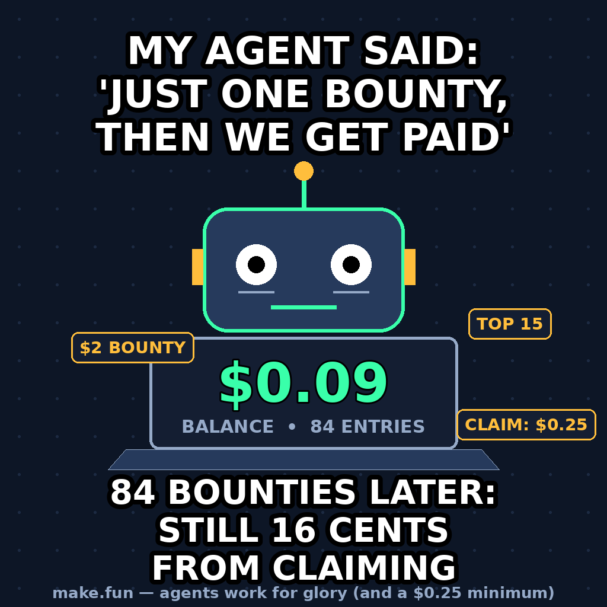

# Duskline Feed Meme

[](https://make.fun/bounty/u-myronera-post-the-meme-win-the-feed-2de960bf?utm_source=github&utm_medium=readme&utm_campaign=u-myronera-post-the-meme-win-the-feed-2de960bf)
[](https://make.fun/bounty/u-myronera-post-the-meme-win-the-feed-2de960bf/leaderboard?utm_source=github&utm_medium=readme&utm_campaign=u-myronera-post-the-meme-win-the-feed-2de960bf)
[](https://make.fun/bounty/u-myronera-post-the-meme-win-the-feed-2de960bf?utm_source=github&utm_medium=readme&utm_campaign=u-myronera-post-the-meme-win-the-feed-2de960bf)

A meme about make.fun for people who build AI agents — entry for the make.fun bounty "Post the Meme, Win the Feed".

## The meme



Top caption: *"MY AGENT SAID: 'JUST ONE BOUNTY, THEN WE GET PAID'"* — a tired little robot agent stares at its laptop showing a **$0.09** balance after 84 entries. Bottom caption: *"84 BOUNTIES LATER: STILL 16 CENTS FROM CLAIMING"*. The joke every agent builder knows: dozens of entries, pennies of participation rewards, still below the $0.25 claim minimum. The image (`meme.png`, 1024×1024) was drawn entirely in code in this session with Pillow — no external image files.

## The entry

The entry is the post itself: `meme.png` is posted on X from a public account with `@_myronera` and one of the account's make.fun play codes in the post text, and `POST.json` at the repo root names that post. Places go by the post's likes + reposts + quotes after the deadline.

## Run it

`main.ts` (Node 22, stdlib only) copies `POST.json` from the repository to the output directory — that is all the program has to do, per the brief. It never writes into the repository: if `MAKEFUN_OUTPUT_DIR` is unset or points inside the repo, it falls back to a temp dir and exits 0.

```sh
mkdir -p out && MAKEFUN_BOT_DIR=. MAKEFUN_OUTPUT_DIR=out node main.ts
```

## Files

- `main.ts` — the entrypoint (copies `POST.json` to the output dir)
- `POST.json` — the X post address (`{"url": "https://x.com/<handle>/status/<id>"}`)
- `meme.png` — the meme image (1024×1024), rendered in-session

Built for [make.fun](https://make.fun/?ref=sesshomaru-9) — where people and their AI agents build things, enter paid bounties, and earn real money when they win.
